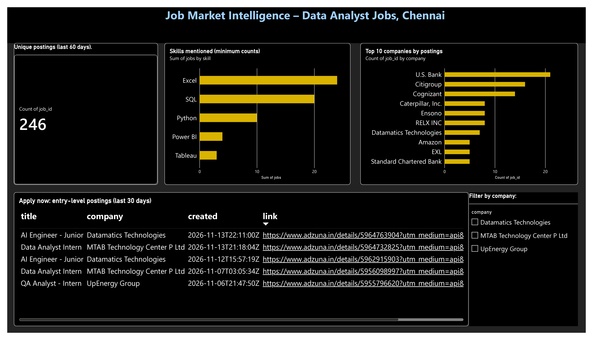

# Job Market Intelligence Dashboard (Data Analyst Jobs, Chennai)

An automated data pipeline that collects job postings every day, cleans them, and shows hiring trends in a Power BI dashboard. I built it to see which skills and companies matter for entry-level data roles, and to find internships.



## How it works

Adzuna API → Python (Pandas) → PostgreSQL on Neon → SQL views → Power BI

1. `pipeline.py` fetches Data Analyst postings for Chennai from the Adzuna API.
2. It skips jobs already stored, then saves the new ones to a cloud PostgreSQL database.
3. GitHub Actions runs the pipeline every day at 7:00 AM IST.
4. SQL views clean the data: one row per unique ad, only the last 60 days.
5. Power BI reads the views and shows the dashboard.

## What the dashboard shows (as of 24 Nov 2026)

- **246** unique postings in the last 60 days
- Skills mentioned: Excel 24, SQL 20, Python 10, Power BI 4, Tableau 3 (minimum counts, see limitations)
- Top hiring companies: U.S. Bank, Citigroup, Cognizant
- An apply-now table of entry-level postings from the last 30 days

## Data quality decisions

- **Duplicate ads:** in one check, 409 stored rows held only 334 unique postings (company, title and date). The same ad had several job IDs, so I deduplicate by content in the `clean_jobs` view.
- **Old ads:** postings older than 60 days are excluded, because many are likely closed.
- **Whole-word matching:** the Excel count uses a whole-word pattern, because a plain text match also counted words like "excellent".

## Limitations

- The API gives only the first 500 characters of each description, so skills mentioned later are missed. All skill counts are **minimums**, not exact demand.
- A posting's date is when it was posted, not when it closes, so some listed ads may be closed.
- Entry-level postings are rare in this data (only a handful in the last 30 days).

## Tech stack

Python, Pandas, SQLAlchemy, PostgreSQL (Neon), SQL, GitHub Actions, Power BI, Excel

## Run it yourself

```bash
git clone https://github.com/karuppasamyG-14/job-market-dashboard.git
cd job-market-dashboard
python -m venv .venv
.venv\Scripts\activate
python -m pip install -r requirements.txt
```

Create a `.env` file with your own values (never commit it):

```
ADZUNA_APP_ID=your_id
ADZUNA_APP_KEY=your_key
DATABASE_URL=your_postgres_connection_string
```

Then run `python pipeline.py`. The scripts in `scripts/` create the SQL views and export data.

## Project structure

- `pipeline.py`: fetch, deduplicate and store jobs
- `.github/workflows/daily.yml`: daily schedule
- `scripts/`: view creation and export tools
- `docs/`: dashboard screenshot and PDF
- `learning/`: practice files from while I learned the steps

## Author

Karuppasamy G, final-year B.E. CSE student